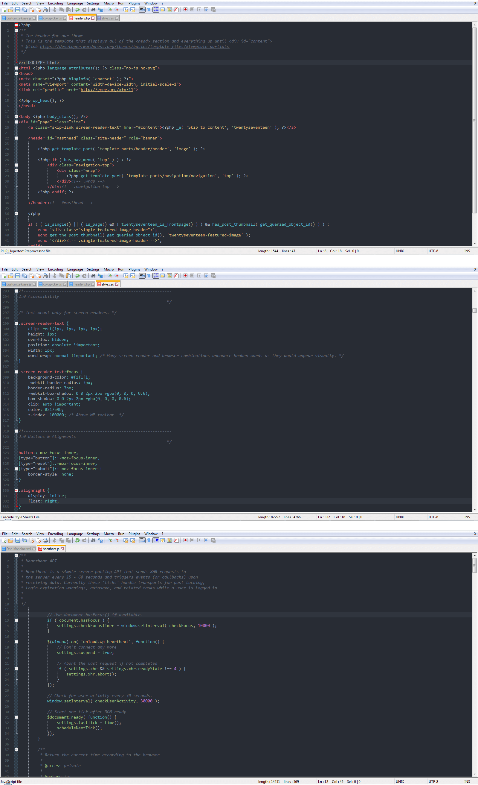

DJD Classic Monokai Theme for Notepad++
=============

Based on the classic Monokai palette by Wimer Hazenberg, this is a Notepad++ port that started from the "One Monokai" XML by mnmlize and has been re-themed to match the original Monokai look-and-feel (not the One-Dark derivative most people call "blue Monokai"). It also adds highlighting for `.yml` / `.yaml` files out of the box, plus companion User Defined Languages for Path of Exile loot filter (`.filter`) and dotenv (`.env`) files.

Tested Languages
----------
PHP / CSS / HTML / JavaScript / XML / YAML / Ruby / C# / C++ / SQL / Perl / Pascal / Python / **PoE loot filters (`.filter`)** / **dotenv (`.env`)** — the last two via the bundled UDLs

Installation
--------------------------

**Theme:**

1. Download [`DJD_Classic_Monokai.xml`](./DJD_Classic_Monokai.xml)
2. Open Notepad++ -> Settings -> Import -> Import style theme
 - OR
2. Start -> Run -> type `%APPDATA%/Notepad++`
3. Copy this file to `themes` folder then Restart Notepad++.
4. Open `Settings->Style Configurator`.
5. Select `DJD Classic Monokai` from the theme drop-down box.
6. Click *Save & Close*

**Extra syntax highlighting for file types Notepad++ doesn't know (optional UDLs):**

Notepad++ colours these languages through User Defined Languages, which are separate files from the theme (themes cannot style UDL languages). Copy either file to `%APPDATA%\Notepad++\userDefineLangs\` and restart Notepad++ — matching files are then highlighted automatically.

*PoE loot filters — [`DJD_PoE_Filter.udl.xml`](./DJD_PoE_Filter.udl.xml) (any `.filter` file):*

- `Show` / `Hide` — red, bold
- conditions (`BaseType`, `ItemLevel`, `Rarity`, …) — orange
- actions (`SetTextColor`, `PlayAlertSound`, `MinimapIcon`, …) — green
- quoted names & value words (`"Orb of Alchemy"`, `Red`, `Star`, …) — yellow
- numbers (RGB triplets, levels, font sizes) — orange
- `#` comments — olive, italic

*dotenv — [`DJD_Env.udl.xml`](./DJD_Env.udl.xml) (any `.env` file):*

- `KEY` before the `=` — red
- value after the `=` — green
- `export` / `true` / `false` — red, bold
- `"quoted"` / `'quoted'` values — yellow
- `#` comments — olive, italic

  `.env.local`, `.env.production` and similar variants don't share the `env` extension — pick *Language → ENV (DJD Monokai)* for them manually.

**Markdown fix (optional but recommended with this theme):**

Notepad++ highlights Markdown with a preinstalled User Defined Language whose emphasis styles (`**bold**`, `*italic*`) are navy `000080` — unreadable on this theme's dark background. To recolour them to Monokai cyan `66D9EF`, edit `%AppData%\Notepad++\userDefineLangs\markdown._preinstalled.udl.xml` and replace every `fgColor="000080"` with `fgColor="66D9EF"`, then restart Notepad++. (Details in [`State Changes.md`](./State%20Changes.md) section 6.)

Screenshot
----------

Credits
------
- Original XML scaffolding: "One Monokai" for Notepad++ by mnmlize (https://github.com/mnmlize/npp-one-monokai-theme), GPL V3.
- Color palette: classic Monokai by Wimer Hazenberg.

Change log
------
See [`State Changes.md`](./State%20Changes.md) for what was edited in this fork.
